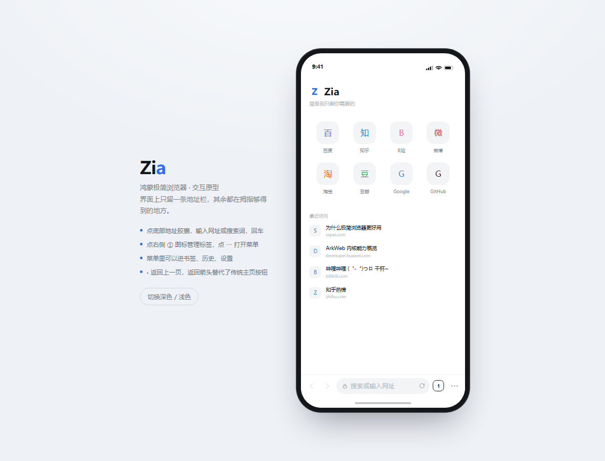
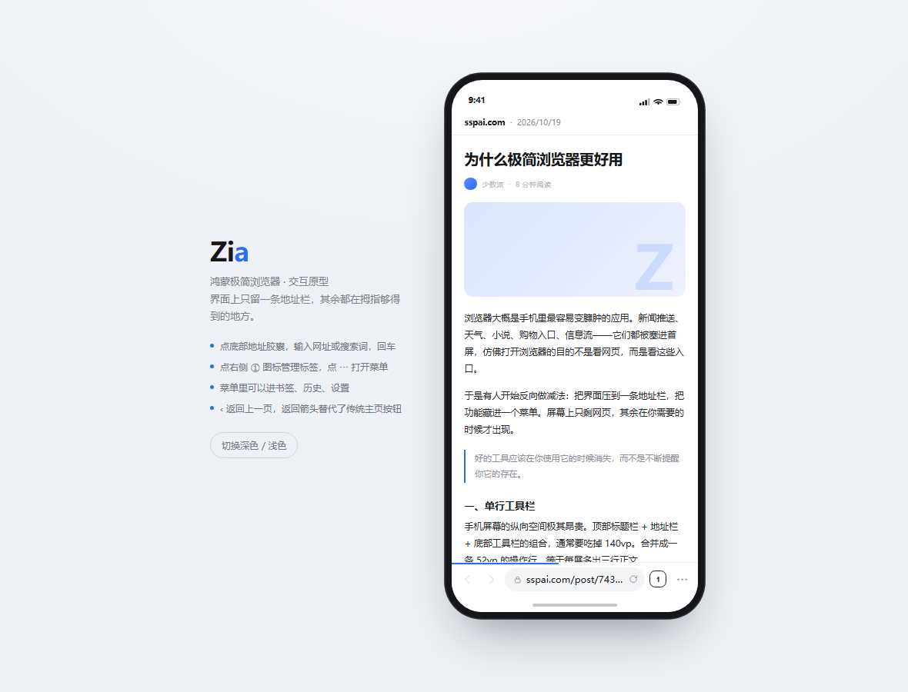
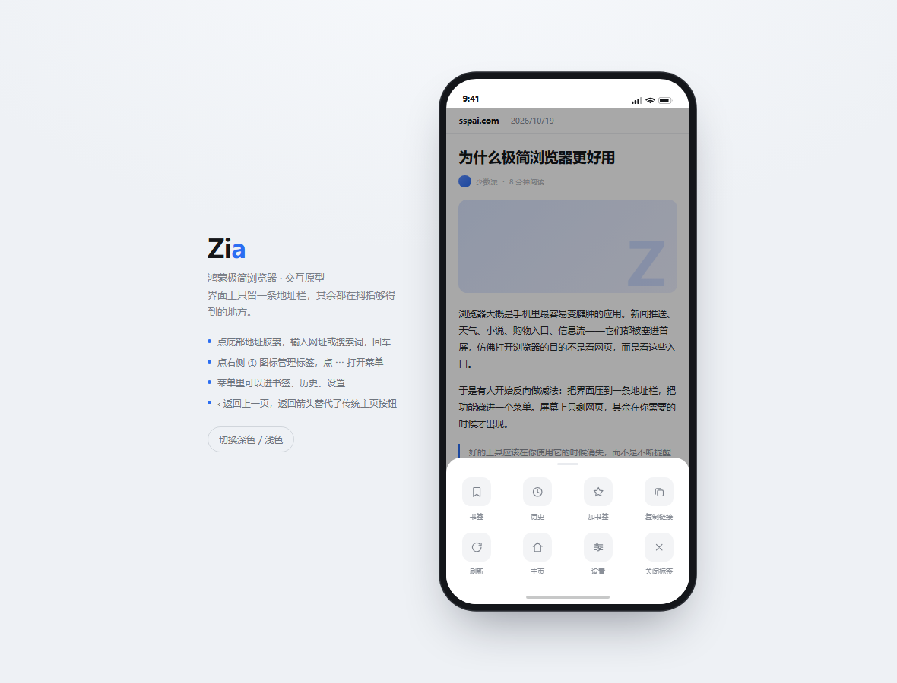

# Aia · 鸿蒙浏览器

一个为 HarmonyOS 写的极简浏览器。设计语言参考 Via 浏览器：**界面上只留一个地址栏**，
其余全部收进菜单和覆盖层，网页本身才是主角。

- 平台：HarmonyOS NEXT（API 12 / 5.0.0）
- 语言：ArkTS + ArkUI 声明式
- 内核：系统 ArkWeb（`@kit.ArkWeb`）
- 包名：`com.aia.browser`

> 先看效果：直接用浏览器打开 `preview/aia-preview.html`，可以点地址栏、开标签、进菜单，
> 支持深色模式。加 `?view=web|tabs|menu|settings|bookmarks` 可以直接跳到某个界面。

| 主页 | 浏览中 | 菜单 |
| --- | --- | --- |
|  |  |  |

---

## 一、设计原则

| 原则 | 落地方式 |
| --- | --- |
| 一屏只有一条工具栏 | 底部单行：前进 / 后退 / 地址胶囊 / 标签数 / 菜单。没有顶部栏、没有标题栏 |
| 新标签页不重复放搜索框 | 地址栏就在拇指边上，主页只放快捷方式和最近访问 |
| 动效克制 | 只有底部弹层升起（240ms FastOutSlowIn）和标签页缩放淡入 |
| 颜色跟着系统走 | 所有颜色写在 `resources/base` 与 `resources/dark` 两套 `color.json` 里，自动响应深浅色 |
| 图标只用线性描边 | 24×24 viewBox，1.7 描边，统一灰度，靠层级而不是靠颜色区分 |

---

## 二、已实现的功能

- **浏览**：地址栏智能识别（输入 `zhihu.com` 直接跳转，输入"天气"走搜索引擎）、加载进度条、停止加载、刷新
- **多标签**：每个标签独立 `WebviewController`，切换标签不丢页面状态；卡片式标签管理、新建、单个关闭、全部关闭
- **地址栏**：点击展开为输入框，回车（Go）提交，取消复位
- **书签**：一键收藏 / 取消收藏，列表打开与删除
- **历史**：自动记录（可在设置里关闭），去重、上限 200 条，列表打开与删除、一键清空
- **搜索**：内置百度 / 必应 / Google / 搜狗 / DuckDuckGo，设置里切换
- **设置**：搜索引擎、默认主页、阻止图片、保存历史、JavaScript 开关、"不追踪"请求、清除记录
- **系统集成**：`entity.system.browsable` 声明，可从其它应用「用 Aia 打开链接」；`onBackPress` 优先处理返回（先关弹层 → 再网页后退 → 最后退出）
- **持久化**：Preferences 本地存储（书签、历史、全部设置）

---

## 三、目录结构

```
Aia/
├── AppScope/
│   ├── app.json5                 应用级配置（包名、版本、图标、名称）
│   └── resources/base/media/app_icon.png
├── entry/src/main/
│   ├── module.json5              模块配置、权限、可浏览链接声明
│   ├── ets/
│   │   ├── entryability/EntryAbility.ets   入口，初始化存储、接收外部链接
│   │   ├── pages/Index.ets                 唯一页面：状态中枢 + 覆盖层编排
│   │   ├── common/
│   │   │   ├── AiaTheme.ets                尺寸 / 圆角 / 字号
│   │   │   ├── SearchEngine.ets             搜索引擎与主页快捷方式
│   │   │   ├── UrlUtils.ets                 地址识别、URL 美化、站点配色
│   │   │   └── Storage.ets                  Preferences 封装
│   │   ├── model/Models.ets                BrowserTab / Bookmark / HistoryEntry / TabInfo
│   │   └── view/
│   │       ├── WebPane.ets                 单个标签的 Web 容器
│   │       ├── AddressBar.ets              底部工具栏（含地址输入态）
│   │       ├── HomeView.ets                新标签页
│   │       ├── MenuSheet.ets               八宫格菜单
│   │       ├── TabsPanel.ets               标签管理
│   │       ├── RecordsPanel.ets            书签 / 历史列表
│   │       └── SettingsPanel.ets           设置
│   └── resources/                          color.json（浅色）/ dark/color.json（深色）/ 35 个 SVG 图标
├── tools/gen_assets.py           图标与应用图标生成脚本（纯标准库）
└── preview/aia-preview.html      可交互 UI 原型（浏览器直接打开）
```

---

## 四、编译运行

1. 安装 **DevEco Studio 5.0.3 Release** 或更新版本，SDK 选 **HarmonyOS 5.0.0(12)**。
2. `File → Open` 选择本目录 `Aia/`，等待 `Sync Now` 完成。
3. 首次运行需要签名：`File → Project Structure → Signing Configs → Automatically generate signature`（需登录华为账号）。
4. 选择真机或模拟器，点击运行。

> 若你的 DevEco 版本更高（API 13+），把 `build-profile.json5` 里的
> `compatibleSdkVersion` 改成对应版本即可，代码无需改动。

命令行构建（可选）：

```bash
hvigorw assembleHap --mode module -p product=default
```

---

## 五、二次开发指引

**换默认搜索引擎**：改 `common/SearchEngine.ets` 里的 `ENGINES` 数组，`%s` 是关键词占位符。

**加广告拦截**：ArkWeb 没有内置的请求拦截扩展，但可以用 `Web` 的 `.onInterceptRequest()`
回调拦截 `request.getRequestUrl()` 命中规则时返回空 `WebResourceResponse`。建议在
`WebPane.ets` 里加一个 `@Prop adBlock: boolean`，规则表放 `resources/rawfile/` 里按行读取。

**加网页内查找**：`controller.searchAllAsync(text)` / `controller.searchNext(true)`，
UI 上做成地址栏下方浮出的一条搜索条即可。

**加分享**：`import { systemShare } from '@kit.ArkUI'`，
`new systemShare.SharedData({ utd: 'general.hyperlink', content: url })` 后 `new systemShare.ShareController(data).show()`。
当前版本为了减少对系统能力的依赖，菜单里先放了「复制链接」（`pasteboard`）。

**换成 Navigation 路由**：现在所有面板都是同一页面内的覆盖层，好处是切换零成本、
动画可控。如果后续要做平板双栏，可以把 `TabsPanel` / `RecordsPanel` 拆成 `NavDestination`。

---

## 六、已知限制

- 没有实现网页截图缩略图（标签卡片用域名配色区分），真机截图需要 `controller.getPageSnapshot()`，成本较高。
- 没有下载管理器；`Web` 的下载需要实现 `onDownloadStart` 并接入 `request.downloadFile`。
- 无痕模式尚未接入（模型层已按标签隔离，只需给 `BrowserTab` 加一个 `incognito` 标记并在记录历史时跳过）。
- `preview/aia-preview.html` 是 UI 原型（HTML/CSS 实现），用于快速确认视觉与交互，不是运行时代码。
